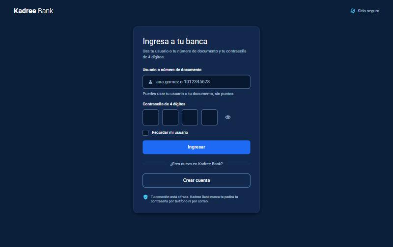
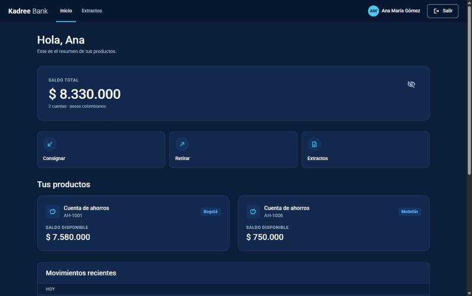
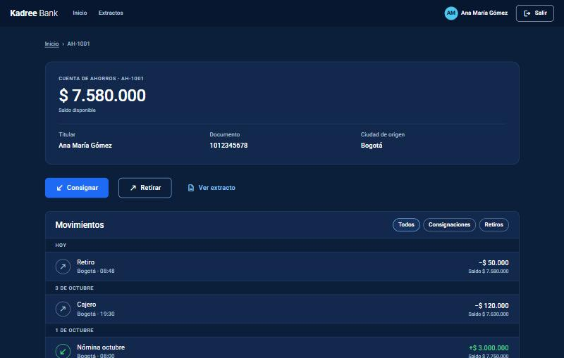
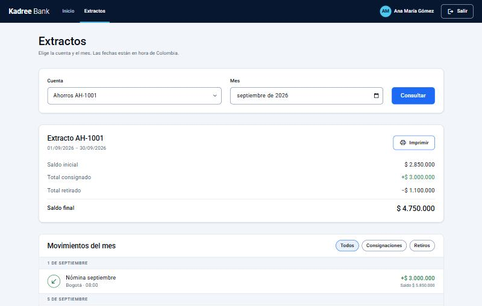
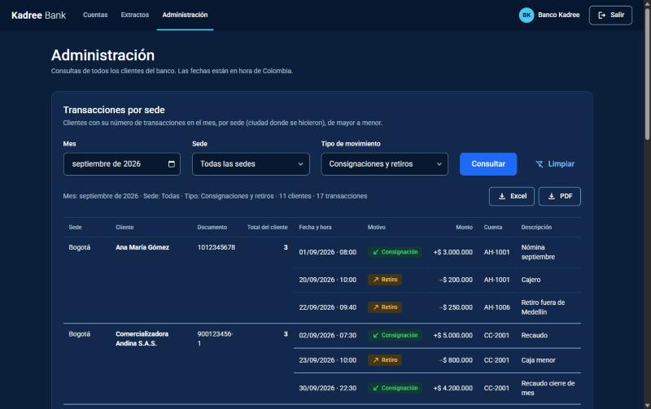
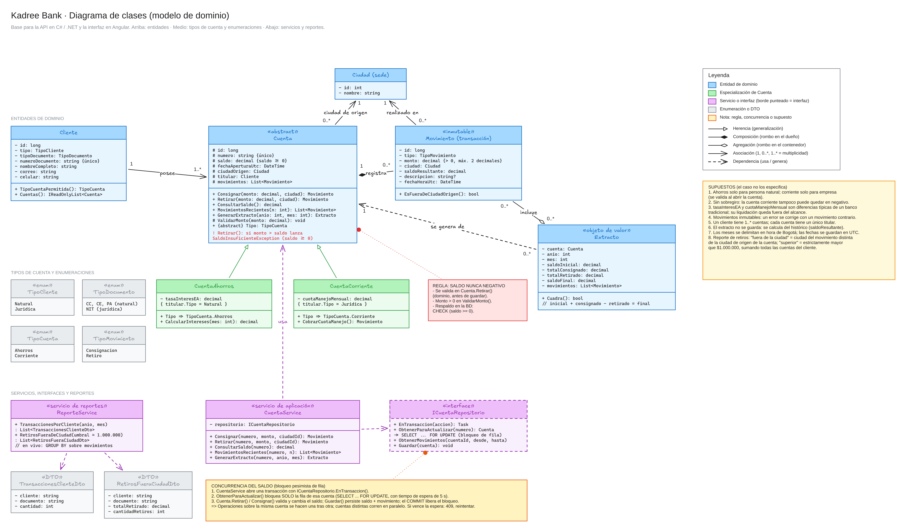
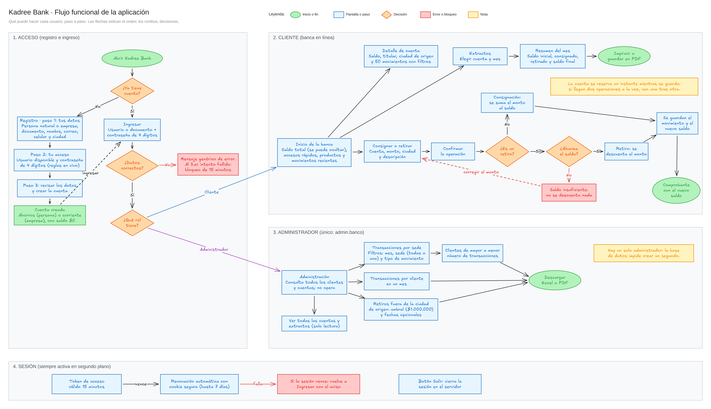

# Kadree Bank

Banca en línea para el caso Kadree Bank:

- Cuentas de **ahorros** (personas naturales) y **corrientes** (empresas).
- **Registro en línea** e **inicio de sesión** con usuario o documento y una contraseña de 4 dígitos, con **JWT**.
- Consignaciones y retiros. El **saldo nunca queda negativo** y se mantiene **consistente ante concurrencia**.
- Saldo, movimientos recientes y extractos mensuales.
- Dos reportes en tiempo real para el rol **Banco**.

| Capa | Tecnología |
|---|---|
| Backend | .NET 9 / C#, ASP.NET Core (API REST), EF Core 9 + Npgsql, JWT Bearer, Swagger |
| Frontend | Angular 22 con **NgModule** (módulos con carga diferida), signals, formularios reactivos tipados, ExcelJS y jsPDF (descargas), Nginx |
| Base de datos | PostgreSQL 17 |
| Entrega | Docker + Docker Compose |

Documentación adicional:

| Documento | Para quién |
|---|---|
| [docs/MANUAL-USUARIO.md](docs/MANUAL-USUARIO.md) | Usuarios finales: cómo registrarse, ingresar, consignar, retirar, ver extractos y usar Administración |
| [docs/TECNICA-BACKEND.md](docs/TECNICA-BACKEND.md) | Desarrolladores backend: arquitectura, seguridad, endpoints, paginación, base de datos y pruebas |
| [docs/TECNICA-FRONTEND.md](docs/TECNICA-FRONTEND.md) | Desarrolladores frontend: módulos, rutas, servicios, sesión, design system y pruebas |
| [docs/diagramas/](docs/diagramas/) | Diagrama de clases y flujo funcional, en imagen (`.png`) y editables (`.excalidraw`) |
| [docs/capturas/](docs/capturas/) | Capturas de pantalla de la aplicación |

---

## Inicio rápido

Si ya tiene **Git** y **Docker Desktop** instalados (vea la [sección 1](#1-qué-instalar-en-el-computador)):

```bash
git clone https://github.com/jeyfredc/kadree-bank.git
cd kadree-bank
cp .env.example .env
```

Edite `.env` y cambie `POSTGRES_PASSWORD`, `JWT_KEY` y `PIN_PEPPER` (vea la [sección 2](#2-ejecutar-la-solución-docker)). Después:

```bash
docker compose up -d --build
```

La primera vez tarda unos minutos, porque descarga las imágenes y compila. Luego abra **http://localhost:4200** e ingrese:

| Rol | Usuario | Contraseña |
|---|---|---|
| Cliente | `ana.gomez` | `2580` |
| Administrador | `admin.banco` | `2580` |

En Windows, `cp` funciona en Git Bash y en PowerShell. En el Símbolo del sistema (cmd) use `copy .env.example .env`.

---

## Capturas de pantalla

| Ingreso | Inicio del cliente |
|---|---|
|  |  |

| Detalle de cuenta | Extracto mensual |
|---|---|
|  |  |

**Administración** (solo `admin.banco`): transacciones por sede, con una fila por transacción, paginación y descarga en Excel o PDF.



---

## Diagramas

### Diagrama de clases (modelo de dominio)



### Flujo funcional de la aplicación



Los archivos `.excalidraw` de [docs/diagramas/](docs/diagramas/) se pueden editar: ábralos en https://excalidraw.com (menú ☰ → *Abrir*) o con la extensión de Excalidraw para VS Code.

---

## 1. Qué instalar en el computador

### Para solo ejecutar la aplicación (recomendado)

| Programa | Versión | Para qué | Descarga |
|---|---|---|---|
| **Docker Desktop** (Windows/macOS) o Docker Engine + Compose v2 (Linux) | 4.x o superior | Levanta la base de datos, la API y el frontend sin instalar nada más | https://www.docker.com/products/docker-desktop |
| **Git** (opcional) | cualquiera reciente | Clonar el repositorio | https://git-scm.com/downloads |

En Windows, Docker Desktop necesita **WSL 2**; el instalador lo ofrece. Después de instalarlo, abra Docker Desktop y espere a que diga *Engine running*.

### Para desarrollar (además de lo anterior)

| Programa | Versión | Para qué | Descarga |
|---|---|---|---|
| **.NET SDK** | 9.0.x | Compilar, ejecutar y probar la API | https://dotnet.microsoft.com/download/dotnet/9.0 |
| **Node.js** | **22.22+ o 24.15+** (lo exige Angular 22; Node 23 **no** sirve) | Compilar y probar el frontend | https://nodejs.org (versión LTS) |
| Editor: **Visual Studio 2022 17.12+** o **VS Code** (con *C# Dev Kit* y *Angular Language Service*) | — | Editar el código | https://visualstudio.microsoft.com · https://code.visualstudio.com |
| **DBeaver** (opcional) | cualquiera | Ver la base de datos | https://dbeaver.io/download |

Compruebe las versiones:

```bash
docker --version
docker compose version
dotnet --version
node --version
```

---

## 2. Ejecutar la solución (Docker)

```bash
# 1. Variables de entorno
cp .env.example .env
```

Edite `.env` y cambie como mínimo estos valores:

| Variable | Qué poner |
|---|---|
| `POSTGRES_PASSWORD` | Una contraseña para la base de datos (sin `;`) |
| `JWT_KEY` | Un texto aleatorio de 32 caracteres o más. Firma los tokens |
| `PIN_PEPPER` | Otro texto aleatorio de 32 caracteres o más. Protege las contraseñas |
| `DEMO_PIN` | La contraseña de 4 dígitos de los usuarios de prueba (por defecto `2580`). Déjela vacía en producción |

Para generar valores aleatorios:

```bash
openssl rand -base64 48
```

En PowerShell, sin openssl:

```powershell
[Convert]::ToBase64String((1..48 | % { Get-Random -Max 256 }))
```

```bash
# 2. Levantar base de datos, API y frontend
docker compose up -d --build

# 3. Verificar que los tres servicios estén arriba (db debe decir "healthy")
docker compose ps
```

| Servicio | URL |
|---|---|
| **Aplicación web** | http://localhost:4200 |
| API (Swagger) | http://localhost:8080/swagger |
| Health check | http://localhost:8080/health |
| PostgreSQL | `localhost:5433` (usuario y base según `.env`) |

La base de datos se crea y se llena con datos de prueba **la primera vez**, cuando el volumen está vacío (scripts de `db/`). **Si ya tenía una versión anterior del proyecto** (sin usuarios ni tokens), recree la base:

```bash
docker compose down -v      # -v borra el volumen de datos
docker compose up -d --build
```

Para detener sin borrar datos: `docker compose down`.

### Usuarios de prueba

Todos usan la contraseña definida en `DEMO_PIN` (por defecto **2580**). Se puede ingresar con el usuario o con el número de documento.

| Usuario | Documento | Rol | Cuentas |
|---|---|---|---|
| `ana.gomez` | 1012345678 | Cliente | AH-1001 (Bogotá), AH-1006 (Medellín) |
| `carlos.perez` | 71234567 | Cliente | AH-1002 (Medellín) |
| `laura.restrepo` | 29876543 | Cliente | AH-1003 (Cali) |
| `jorge.martinez` | 80123456 | Cliente | AH-1004 (Bogotá) |
| `andina.sas` | 900123456-1 | Cliente (empresa) | CC-2001 (Bogotá) |
| `tecnocaribe` | 900654321-7 | Cliente (empresa) | CC-2002 (Barranquilla) |
| `admin.banco` | — | **Banco (administrador)** | Sección **Administración** (`/admin`): consultas de todos los clientes por sede, reportes y descargas en Excel/PDF. Consulta todas las cuentas; no opera |

**Cómo ingresar como administrador:** abra http://localhost:4200, escriba el usuario `admin.banco` y la contraseña `2580` (o el valor de `DEMO_PIN`). Entrará directamente a **Administración**. El administrador es **único**: el índice `uq_users_single_admin` de la base impide crear un segundo usuario con rol Banco.

Al arrancar, la API asigna `DEMO_PIN` a los usuarios que todavía no tienen contraseña (`pin_hash = 'PENDIENTE'` en `db/02_seed.sql`). La contraseña no queda escrita en el código ni en los scripts.

### Variables de entorno (`.env`)

| Variable | Uso | Por defecto |
|---|---|---|
| `POSTGRES_DB`, `POSTGRES_USER` | Base de datos y usuario | `kadreebank`, `kadree` |
| `POSTGRES_PASSWORD` | Contraseña de la base (obligatoria; sin `;`) | — |
| `DB_PORT`, `API_PORT`, `WEB_PORT` | Puertos publicados en el host | `5433`, `8080`, `4200` |
| `BANK_TIMEZONE` | Zona horaria con la que se delimitan los meses | `America/Bogota` |
| `SWAGGER_ENABLED` | Publicar Swagger | `true` |
| `CORS_ALLOWED_ORIGINS` | Orígenes permitidos si el frontend no pasa por el proxy | vacío |
| `JWT_KEY` | Clave HS256 de los tokens (obligatoria, ≥ 32 bytes) | — |
| `PIN_PEPPER` | Pepper de las contraseñas (obligatorio, ≥ 32 caracteres). **Si lo cambia, las contraseñas existentes dejan de funcionar** | — |
| `DEMO_PIN` | Contraseña de los usuarios de prueba | `2580` |

La API recibe su configuración por variables con la convención de .NET (`ConnectionStrings__DefaultConnection`, `Jwt__Key`, `Auth__PinPepper`…). Si falta `JWT_KEY` o `PIN_PEPPER`, `docker compose` se niega a arrancar y la API valida su longitud al iniciar.

`.env` está en `.gitignore`: **no lo suba al repositorio**.

---

## 3. Desarrollo local sin contenedores para la API y el frontend

```bash
# Solo la base de datos en Docker
docker compose up -d db
```

Guarde los secretos de la API en **user-secrets** una sola vez; no quedan en el repositorio. Use los mismos valores de `.env`: el `PIN_PEPPER` **debe ser igual** en Docker y en local, o las contraseñas no coincidirán. El puerto es **5433** (el de Docker), no 5432.

```bash
dotnet user-secrets set "ConnectionStrings:DefaultConnection" "Host=localhost;Port=5433;Database=kadreebank;Username=kadree;Password=<la de .env>" --project backend/KadreeBank.Api
dotnet user-secrets set "Jwt:Key" "<JWT_KEY de .env>" --project backend/KadreeBank.Api
dotnet user-secrets set "Auth:PinPepper" "<PIN_PEPPER de .env>" --project backend/KadreeBank.Api
dotnet user-secrets set "Auth:DemoPin" "2580" --project backend/KadreeBank.Api
```

En Windows, los user-secrets quedan en `%APPDATA%\Microsoft\UserSecrets\<UserSecretsId>\secrets.json`; en Linux y macOS, en `~/.microsoft/usersecrets/<UserSecretsId>/secrets.json`.

```bash
# API en http://localhost:8080 (perfil "http", entorno Development)
dotnet run --project backend/KadreeBank.Api
```

```bash
# Frontend en http://localhost:4200 (proxy.conf.json envía /api a :8080)
cd frontend
npm ci
npx ng serve
```

---

## 4. Pruebas

```bash
cd backend
dotnet test                                   # unitarias + integración
dotnet test KadreeBank.UnitTests             # solo unitarias (sin Docker)
```

- **Unitarias (73)**: reglas de las entidades, servicios, validación de DTOs, calendario, concurrencia y seguridad. La seguridad incluye el hash de la contraseña, las reglas de la contraseña, el JWT, el bloqueo tras 3 intentos, la rotación del refresh token y la autorización por dueño y por rol.
- **Integración (18)**: levantan un PostgreSQL desechable con **Testcontainers** y aplican `db/*.sql`. Cubren:
  - Concurrencia real, el `CHECK` del saldo y la inmutabilidad de los movimientos.
  - Ambos reportes y el extracto.
  - El contrato HTTP: 401 sin token, una cuenta ajena da 404, reportes 403 para un cliente, 422, bloqueo 423, y el registro completo con 201 y 409.

  **Requieren Docker**; si no está disponible, se marcan como omitidas.

Frontend (17 pruebas con Vitest):

```bash
cd frontend
npm ci
npx ng test --watch=false
npx ng build
```

Si su Node local no es compatible con Angular 22, puede compilar y probar dentro de un contenedor:

```bash
docker run --rm -v "$PWD/frontend:/app" -v kb_fe_nm:/app/node_modules -w /app node:24-alpine sh -c "npm ci && npx ng test --watch=false && npx ng build"
```

---

## 5. Estructura

```
kadree-bank/
├── docker-compose.yml        # db + api + web
├── .env.example              # variables externalizadas (copiar a .env)
├── db/
│   ├── 01_schema.sql         # esquema, CHECK, índices, trigger, usuarios y refresh tokens
│   └── 02_seed.sql           # datos de prueba
├── docs/                     # manual de usuario y documentación técnica
│   ├── diagramas/            # diagrama de clases y flujo funcional (.png y .excalidraw)
│   └── capturas/             # capturas de pantalla de la aplicación
├── backend/
│   ├── KadreeBank.Api/
│   │   ├── Controllers/      # Auth, Accounts, Cities, Reports
│   │   ├── Interfaces/       # contratos de servicios y DAO, ICurrentUser
│   │   ├── Services/         # casos de uso; devuelven ApiResponse<T>
│   │   ├── Models/
│   │   │   ├── Entities/     # Account, Customer, Movement, City, User, RefreshToken
│   │   │   ├── DAO/          # acceso a datos con Entity Framework
│   │   │   └── DTOs/         # Accounts, Auth, Cities, Reports, Responses
│   │   ├── Data/             # KadreeBankDbContext
│   │   ├── Exceptions/       # excepciones de negocio y de seguridad
│   │   ├── Middleware/       # ApiExceptionHandler (errores → ApiResponse)
│   │   ├── Helpers/          # JWT, hash de contraseña, reglas de contraseña, usuario actual…
│   │   └── Program.cs
│   ├── KadreeBank.UnitTests/
│   └── KadreeBank.IntegrationTests/
└── frontend/
    ├── nginx/default.conf.template   # SPA + proxy /api → API
    └── src/
        ├── styles/                   # tokens y componentes del design system
        └── app/
            ├── app.module.ts, app-routing.module.ts
            ├── core/                 # models (DTOs), services, interceptors, guards, utils
            ├── shared/               # SharedModule: componentes y pipes reutilizables
            ├── layout/               # barra superior
            └── features/
                ├── auth/             # AuthModule: ingreso y registro
                ├── banking/          # BankingModule: inicio, cuentas, operaciones, extractos
                └── reports/          # ReportsModule: reportes del banco
```

---

## 6. Resumen de la API

Documentación interactiva: http://localhost:8080/swagger. Para probar ahí, use **Authorize** y pegue el `accessToken` que devuelve `/api/auth/login`.

| Método | Ruta | Acceso | Descripción |
|---|---|---|---|
| POST | `/api/auth/login` | Público | `{ identifier, pin }` → access token y cookie de refresco |
| POST | `/api/auth/refresh` | Cookie | Nuevo access token; rota el refresh token |
| POST | `/api/auth/logout` | Público | Revoca la sesión y borra la cookie |
| POST | `/api/auth/register` | Público | Crea cliente, cuenta y usuario |
| GET | `/api/auth/username-availability?username=` | Público | ¿El usuario está libre? |
| GET | `/api/auth/me` | Sesión | Usuario actual |
| GET | `/api/cities` | Público | Ciudades |
| GET | `/api/accounts` | Sesión | Cuentas propias (o todas, si es Banco) |
| GET | `/api/accounts/{number}` | Dueño o Banco | Saldo y datos |
| GET | `/api/accounts/{number}/movements?limit=20` | Dueño o Banco | Movimientos recientes |
| GET | `/api/accounts/{number}/statements/{year}/{month}` | Dueño o Banco | Extracto mensual |
| POST | `/api/accounts/{number}/deposits` | Dueño (Cliente) | Consignación `{ amount, cityId, description? }` |
| POST | `/api/accounts/{number}/withdrawals` | Dueño (Cliente) | Retiro `{ amount, cityId, description? }` |
| GET | `/api/reports/transactions-by-branch?year=&month=&cityId=&type=&page=&pageSize=` | Banco | Transacciones por sede, paginadas por cliente; `cityId` y `type` (`Consignacion` o `Retiro`) son opcionales |
| GET | `/api/reports/transactions-by-customer?year=&month=&page=&pageSize=` | Banco | Reporte 1, paginado |
| GET | `/api/reports/out-of-city-withdrawals?minTotal=1000000&from=&to=&page=&pageSize=` | Banco | Reporte 2, paginado |

Los reportes se paginan en el servidor: `page` empieza en 1 y `pageSize` va de 1 a 100 (por defecto 20). `data` trae `items`, `page`, `pageSize`, `totalItems` y `totalPages`.

El detalle (códigos de error, seguridad, concurrencia y decisiones de diseño) está en [docs/TECNICA-BACKEND.md](docs/TECNICA-BACKEND.md).

---

## 7. Datos de prueba y resultados esperados

Seis ciudades, cuatro personas naturales con cuentas de ahorros (`AH-…`) y dos empresas con cuentas corrientes (`CC-…`), con movimientos entre agosto y octubre de 2026.

**Reporte 1, septiembre de 2026**: Ana María Gómez 5 · Comercializadora Andina 5 · Laura Restrepo 3 · Carlos Andrés Pérez 2 · Jorge Martínez 1 · Tecnologías del Caribe 1.

**Reporte 2, umbral de $1.000.000**: Comercializadora Andina S.A.S. $3.500.000 · Carlos Andrés Pérez $1.650.000 · Ana María Gómez $1.150.000. Jorge Martínez retiró **exactamente** $1.000.000 fuera de su ciudad y no aparece, porque no lo supera.

Para ver el error de saldo: ingrese como `ana.gomez`, elija `AH-1006` (saldo $750.000) e intente retirar $1.000.000.

---

## 8. Solución de problemas

| Síntoma | Causa y solución |
|---|---|
| `docker compose` dice que falta `JWT_KEY` o `PIN_PEPPER` | Copie `.env.example` a `.env` y complete esos valores |
| La API no arranca: *Falta 'Jwt:Key' o tiene menos de 32 bytes* (o lo mismo con `Auth:PinPepper`) | Use valores más largos en `JWT_KEY` y `PIN_PEPPER` |
| *la autentificación password falló para el usuario «kadree»* | La base se creó con otra `POSTGRES_PASSWORD`. Use la original, o recree la base con `docker compose down -v` |
| Los usuarios de prueba no pueden ingresar | `DEMO_PIN` vacío, o la base es de una versión anterior: `docker compose down -v` y vuelva a levantar |
| Las contraseñas funcionan en Docker pero no en local (o al revés) | El `PIN_PEPPER` de user-secrets debe ser igual al de `.env` |
| DBeaver no conecta | El puerto es **5433**, no 5432 (este puede ser otro PostgreSQL instalado en su equipo) |
| `npm ci` falla con *Unsupported engine* | Node 23 no es compatible con Angular 22: instale Node 22.22+ o 24 LTS, o use el contenedor de la sección 4 |
| «Demasiados intentos» al ingresar | Límite de 10 intentos por minuto por IP: espere un minuto |
| «Acceso bloqueado» | Tres contraseñas erradas bloquean el usuario 15 minutos; se desbloquea solo |

